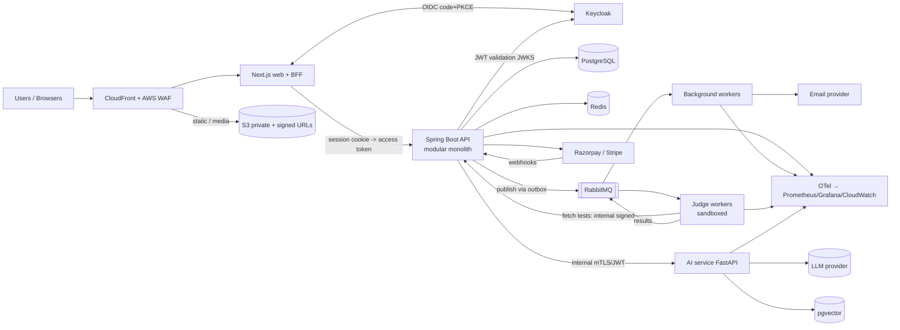
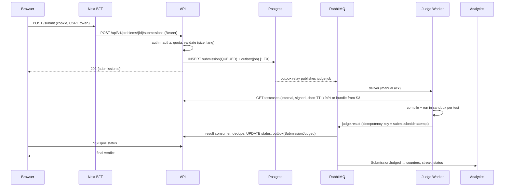

# 03 — System Architecture

> **Portability note (2026-11-23):** hosting provider is **Pending Decision**. AWS services named in this document (ECS, RDS, ElastiCache, S3, CloudFront, WAF, Secrets Manager, Amazon MQ, Terraform modules) are a *reference deployment*, not a requirement. The application must run from Docker images with environment-based configuration on any provider; see doc 15 and ADR-019.

## 1. Style

**Modular monolith** (Spring Boot) + **separately deployed workloads** where isolation or scaling demands it:

| Deployable | Why separate |
|---|---|
| `web` (Next.js: SSR + BFF) | Different runtime/scaling; holds the browser session |
| `api` (Spring Boot modular monolith) | Transactional core |
| `judge-worker` | Untrusted code; different security posture & scaling |
| `worker` (Spring Boot, same codebase, different profile) | Background consumers (email, analytics, certificates, outbox relay) |
| `ai-service` (FastAPI) — later | Different language/ecosystem; cost isolation |
| Keycloak | Identity provider |
| PostgreSQL, Redis, RabbitMQ, S3/CloudFront | Data/infra |

`api` and `worker` are one Maven artifact started with different Spring profiles — less duplication than two codebases, still scalable separately.

## 2. Context diagram

## 3. Backend domain modules

Packages under `com.engineerhub.<module>`; each exposes a **public API package** (`api`: facade interfaces, DTOs, events) and hides `internal` (entities, repos, services). Enforced with **Spring Modulith** `ApplicationModules.verify()` plus ArchUnit.

Modules: `identity`, `user`, `catalog` (courses/lessons/content), `learning` (enrollment/progress/notes), `roadmap`, `problem`, `submission`, `judge` (integration/orchestration only), `quiz`, `interview`, `analytics`, `subscription`, `payment`, `community`, `notification`, `admin` (audit, settings), `shared` (kernel: errors, ids, security utils, outbox).

Rules:
1. No module touches another's repositories/tables. Cross-module = facade call (sync, read-mostly) or **domain event** (async, state change).
2. Cross-module foreign keys are allowed **at the DB level for integrity only in a few agreed places** (e.g. `user_id`); otherwise reference by id without JPA associations.
3. Events published through the **transactional outbox** (table in same TX → relay publishes to RabbitMQ).

## 4. Key flows

### 4.1 Submission (see `10-CODE-EXECUTION-ARCHITECTURE.md` for detail)

### 4.2 Payments
Checkout creates `pending` subscription → provider order → client pays → **webhook** (signature verified, event id stored unique) → state transition + entitlement refresh + outbox event. Frontend "success" page only polls our API; never grants access itself.

### 4.3 Content access
`ContentAccessPolicy.canRead(user, lesson)` = published ∧ (free ∨ previewFlag ∨ entitlement(plan covers course) ∨ staff-scope). Premium bodies are **not serialized** when denied; teaser metadata only.

## 5. Cross-cutting
- **API**: REST `/api/v1`, OpenAPI via springdoc, RFC 9457 problem+json errors, cursor/page pagination.
- **Caching**: Redis (cache-aside, short TTLs, explicit eviction by events). Postgres authoritative.
- **Rate limiting**: edge (WAF) + app-level token bucket in Redis keyed by user/IP/route class.
- **Search**: Postgres FTS + `pg_trgm` initially; OpenSearch only when needed.
- **Config**: 12-factor env; Spring profiles `local`, `test`, `staging`, `prod`.
- **Id strategy**: UUIDv7 (time-ordered; better index locality) for domain entities; bigint identity for high-volume append tables (activity events) where ids needn't be public.
- **Time**: UTC `timestamptz` everywhere; user timezone stored for streak logic.

## 6. Evolution path
Extract in this order if/when needed: judge orchestration (already separate workers) → AI → notifications → analytics → catalog read-side. Modulith events become RabbitMQ topics (already the case via outbox), so extraction is mostly moving a module + its tables.
