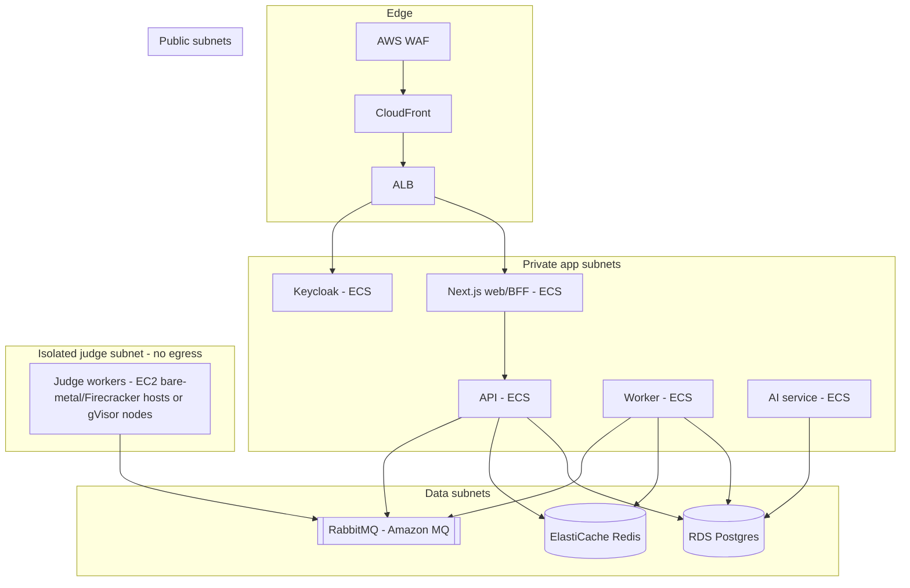
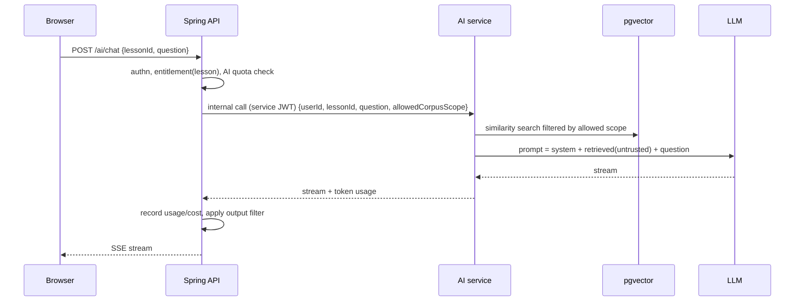

# 04 — High-Level Design

> **Portability note (2026-11-23):** hosting provider is **Pending Decision**. AWS services named in this document (ECS, RDS, ElastiCache, S3, CloudFront, WAF, Secrets Manager, Amazon MQ, Terraform modules) are a *reference deployment*, not a requirement. The application must run from Docker images with environment-based configuration on any provider; see doc 15 and ADR-019.

Complements `03-SYSTEM-ARCHITECTURE.md` (context diagram, submission and payment flows).

## 1. Component diagram



## 2. Authentication flow (BFF pattern)

```mermaid
sequenceDiagram
  participant B as Browser
  participant N as Next.js BFF
  participant K as Keycloak
  participant A as Spring API
  B->>N: GET /auth/login
  N->>N: generate state, nonce, PKCE verifier
  N-->>B: 302 Keycloak /auth (code_challenge)
  B->>K: authenticate (+MFA if admin)
  K-->>B: 302 /auth/callback?code&state
  B->>N: callback
  N->>K: token exchange (code + verifier, confidential client)
  N->>N: store tokens SERVER-SIDE in session store (Redis); set HttpOnly Secure SameSite=Lax cookie (opaque session id)
  B->>N: API call via /api/proxy/* (cookie + CSRF header)
  N->>A: Authorization: Bearer access_token (refresh transparently)
  A->>A: validate JWT (iss, aud, exp, signature via JWKS), map authorities
```

Tokens never reach browser JS. Refresh-token rotation enabled in Keycloak; reuse detection revokes the session.

## 3. Background processing

Outbox table → relay (poll `FOR UPDATE SKIP LOCKED`, publish with publisher confirms) → RabbitMQ topic exchange `domain.events` → per-consumer durable queues with DLX + retry (TTL-delay queues, max attempts) → idempotent consumers (processed-message table keyed by `(consumer, messageId)`).

Queues (initial): `judge.jobs`, `judge.results`, `email.send`, `analytics.events`, `certificates.generate`, `notifications.dispatch`, `*.dlq`.

## 4. AI integration flow


Retrieved text is treated as untrusted data (prompt-injection defense); entitlement filtering happens **before retrieval**.

## 5. Data flow summaries
- **Reading a lesson**: Browser → Next SSR (public/free: cacheable at CDN with ISR; premium: dynamic, per-user) → API → Redis → PG.
- **Progress write**: `POST /lessons/{id}/complete` → TX (`lesson_progress` upsert + outbox) → analytics consumer updates counters/streak/leaderboard.
- **Media**: Upload via presigned S3 PUT (type/size-constrained) → virus scan (ClamAV Lambda/worker) → status `ready` → served via CloudFront signed URL/cookie.

## 6. Environments
`local` (Compose) → `staging` (prod-like, small) → `prod`. Separate AWS accounts for staging/prod recommended.
