# 06 — Database Design (Proposal)

PostgreSQL, Flyway-migrated, one schema per module (`identity`, `catalog`, `learning`, …) to make ownership explicit and extraction easier. Cross-schema FKs only to `identity.users(id)` (and noted exceptions). All `timestamptz`; audit columns `created_at, updated_at` (+ `created_by` on authored content); optimistic locking `version` where concurrent edits are plausible.

Conventions: UUIDv7 PKs for public entities; `bigint generated always as identity` for append-only high-volume tables; `slug` unique + citext/lower index; enums as `text` + CHECK (easier migration than PG enums); JSONB only where noted.

## 1. ER overview

```mermaid
erDiagram
  USERS ||--|| USER_PROFILES : has
  USERS ||--o{ EXTERNAL_IDENTITIES : links
  USERS ||--o{ USER_ROLES : has
  ROLES ||--o{ ROLE_PERMISSIONS : grants
  USERS ||--o{ SCOPED_GRANTS : has

  COURSES ||--o{ SECTIONS : contains
  SECTIONS ||--o{ LESSONS : contains
  LESSONS ||--o{ CONTENT_BLOCKS : contains
  COURSES }o--o{ COURSES : prerequisite
  COURSES }o--o{ USERS : instructors
  CATEGORIES ||--o{ COURSES : classifies

  USERS ||--o{ ENROLLMENTS : has
  COURSES ||--o{ ENROLLMENTS : has
  USERS ||--o{ LESSON_PROGRESS : has
  LESSONS ||--o{ LESSON_PROGRESS : has
  USERS ||--o{ NOTES : writes
  USERS ||--o{ HIGHLIGHTS : makes
  USERS ||--o{ BOOKMARKS : saves

  PROBLEMS ||--o{ TEST_CASES : has
  PROBLEMS ||--o{ PROBLEM_TOPICS : tagged
  TOPICS ||--o{ PROBLEM_TOPICS : tagged
  PROBLEMS ||--o{ PROBLEM_PATTERNS : tagged
  PROBLEMS ||--o{ PROBLEM_COMPANIES : asked_at
  COMPANIES ||--o{ PROBLEM_COMPANIES : asked_at
  PROBLEMS ||--o{ SOLUTION_APPROACHES : has
  PROBLEMS ||--o{ PROBLEM_LANGUAGE_CONFIGS : supports
  LANGUAGES ||--o{ PROBLEM_LANGUAGE_CONFIGS : supports

  USERS ||--o{ SUBMISSIONS : makes
  PROBLEMS ||--o{ SUBMISSIONS : receives
  SUBMISSIONS ||--o{ SUBMISSION_RESULTS : has
  USERS ||--o{ USER_PROBLEM_STATUS : has

  QUIZZES ||--o{ QUIZ_QUESTIONS : has
  QUIZ_QUESTIONS ||--o{ QUIZ_OPTIONS : has
  USERS ||--o{ QUIZ_ATTEMPTS : makes

  PLANS ||--o{ PLAN_PRICES : priced
  PLANS ||--o{ PLAN_ENTITLEMENTS : grants
  USERS ||--o{ SUBSCRIPTIONS : holds
  SUBSCRIPTIONS ||--o{ PAYMENTS : billed
  PAYMENTS ||--o| INVOICES : documented

  USERS ||--o{ INTERVIEW_SESSIONS : takes
  INTERVIEW_SESSIONS ||--o{ INTERVIEW_TURNS : has
```

## 2. Tables by module (key columns, constraints, indexes)

### identity
- `users(id, keycloak_sub UNIQUE, email citext UNIQUE, email_verified, username citext UNIQUE, status CHECK(active|suspended|pending_deletion|deleted), timezone, locale, created_at, deleted_at)` — password hashes live in **Keycloak only**.
- `user_profiles(user_id PK/FK, display_name, avatar_key, bio, website, github_url, linkedin_url, visibility jsonb)` — PII.
- `external_identities(id, user_id FK, provider, provider_subject, UNIQUE(provider, provider_subject))`.
- `roles(id, code UNIQUE, system bool)`, `permissions(id, code UNIQUE)`, `role_permissions(role_id, permission_id PK both)`, `user_roles(user_id, role_id, granted_by, granted_at, PK(user_id, role_id))`, `scoped_grants(id, user_id, permission_id, resource_type, resource_id, granted_by, expires_at, UNIQUE(user_id, permission_id, resource_type, resource_id))`.
- `user_preferences(user_id PK, preferred_language, reader_settings jsonb, notification_prefs jsonb)`.

### catalog
- `categories(id, slug UNIQUE, name, parent_id)`.
- `courses(id, slug UNIQUE, title, description, thumbnail_key, banner_key, category_id, difficulty, est_minutes, access_tier CHECK(free|premium), status CHECK(draft|in_review|published|archived), published_at, version, created_by)` idx(status, category_id), FTS gin on title/description.
- `course_prerequisites(course_id, prerequisite_id, PK both, CHECK ≠)`.
- `course_instructors(course_id, user_id, role)`.
- `sections(id, course_id FK, title, position, UNIQUE(course_id, position) DEFERRABLE)`.
- `lessons(id, section_id FK, course_id FK (denorm for fast lookup), slug, title, position, access_tier, free_preview bool, est_read_min, priority, status, published_at, updated_content_at)` UNIQUE(course_id, slug).
- `content_blocks(id, lesson_id FK, position, type, schema_version, data jsonb, UNIQUE(lesson_id, position) DEFERRABLE)` — JSONB justified: heterogeneous block payloads.
- `content_revisions(id, entity_type, entity_id, version, snapshot jsonb, author_id, created_at)` — version history; `review_requests(...)`.
- `media_assets(id, owner_id, s3_key, mime, size, sha256, scan_status, access CHECK(public|private))`.
- `topics(id, slug UNIQUE, name, parent_id, position)`, `patterns(id, slug, name, description)`, `companies(id, slug, name, logo_key)`.

### learning
- `enrollments(id, user_id, course_id, enrolled_at, last_lesson_id, completed_at, UNIQUE(user_id, course_id))`.
- `lesson_progress(user_id, lesson_id, status CHECK(in_progress|completed), completed_at, scroll_pct, PK(user_id, lesson_id))` idx(user_id, status).
- `course_progress_counters(user_id, course_id, completed_count, total_count_snapshot, PK both)` — denormalized, updated by event consumer.
- `notes(id, user_id, lesson_id, block_id, anchor jsonb, body text, created_at)`; `highlights(id, user_id, lesson_id, block_id, start, end, quoted_text, color)`; `bookmarks(user_id, target_type, target_id, PK(user_id, target_type, target_id))`.
- `certificates(id, user_id, course_id, serial UNIQUE, issued_at, s3_key)`.

### roadmap
`roadmaps(id, slug, title, status)`, `roadmap_steps(id, roadmap_id, ref_type, ref_id, position)`, `roadmap_step_prereqs(step_id, prereq_step_id)` (acyclicity validated in service), `user_roadmaps(user_id, roadmap_id, started_at)`.

### problem
- `problems(id, slug UNIQUE, title, statement jsonb/markdown, difficulty, input_format, output_format, constraints, time_limit_ms, memory_limit_mb, access_tier, frequency_score smallint, status, testcase_version int, checker_type CHECK(exact|token|float|special), created_by, published_at)` idx(status, difficulty), FTS.
- `problem_topics`, `problem_patterns`, `problem_companies(problem_id, company_id, frequency, PK both)`, `related_problems(problem_id, related_id)`.
- `test_cases(id, problem_id, version, ordinal, is_sample bool, input_key, expected_key (S3 or inline if small), weight, UNIQUE(problem_id, version, ordinal))` — hidden test data stored in **private bucket**, readable only by judge role; DB row holds pointers + sha256.
- `problem_hints(problem_id, position, body)`, `editorials(problem_id, body, status)`, `solution_approaches(id, problem_id, position, title, body, time_complexity, space_complexity, is_optimal)`, `solution_code(approach_id, language_id, code)`.
- `languages(id, code UNIQUE, name, version, compile_cmd, run_cmd, file_ext, enabled, limits_multiplier numeric)`.
- `problem_language_configs(problem_id, language_id, starter_code, driver_template_key, PK both)`.

### submission
- `submissions(id uuid, user_id, problem_id, language_id, source_code text (size-capped), source_sha256, status, verdict, runtime_ms, memory_kb, testcase_version, attempt, mode CHECK(run|submit), created_at, judged_at)` — **partition by month on created_at** once volume warrants (design PK to include created_at if partitioned; decide at Phase 0/OQ). idx(user_id, created_at desc), idx(problem_id, user_id, created_at desc), idx(status) partial where status in (QUEUED,RUNNING).
- `submission_results(submission_id, attempt, test_case_id, verdict, time_ms, memory_kb, stdout_trunc, stderr_trunc, PK(submission_id, attempt, test_case_id))` — output visible only for sample tests.
- `user_problem_status(user_id, problem_id, status CHECK(attempted|solved), first_solved_at, best_runtime, attempts_count, PK both)` — "solved" never reverts.
- `processed_messages(consumer, message_id, processed_at, PK both)` — idempotency.

### quiz
`quizzes(id, scope_type, scope_id, title, time_limit_s, status)`, `quiz_questions(id, quiz_id, type, body jsonb, explanation, marks, difficulty, position)`, `quiz_options(id, question_id, body, is_correct, position)`, `quiz_attempts(id, user_id, quiz_id, started_at, submitted_at, score, answers jsonb)`.

### interview
`interview_tracks`, `interview_questions(id, track, body, company_id?, difficulty)`, `interview_sessions(id, user_id, type, status, started_at, ended_at, config jsonb)`, `interview_turns(id, session_id, role, content, created_at)`, `interview_reports(session_id PK, scores jsonb, feedback, model, disclaimer_ack)`.

### analytics
`activity_events(id bigint, user_id, type, ref_id, occurred_at)` (partition monthly; retention policy), `daily_user_stats(user_id, day, submissions, accepted, minutes_learned, lessons_completed, PK(user_id, day))`, `user_streaks(user_id PK, current, longest, last_active_day)`, `user_topic_proficiency(user_id, topic_id, score, updated_at)`, `achievements(id, code, ...)`, `user_achievements(user_id, achievement_id, earned_at)`. Leaderboards live in Redis ZSETs, rebuildable from PG.

### subscription / payment
`plans(id, code, name, active)`, `plan_prices(id, plan_id, currency, amount_minor, period CHECK(month|year), provider_price_ref)`, `plan_entitlements(plan_id, entitlement_code)`, `subscriptions(id, user_id, plan_id, status, provider, provider_sub_ref UNIQUE, current_period_start/end, cancel_at_period_end, created_at)` idx(user_id, status), `payments(id, subscription_id, provider, provider_payment_ref UNIQUE, amount_minor, currency, status, created_at)`, `invoices(id, payment_id, number UNIQUE, tax jsonb, s3_key)`, `refunds(id, payment_id, amount_minor, status, requested_by, approved_by)`, **`webhook_events(provider, event_id, received_at, payload jsonb, processed_at, PK(provider, event_id))`** for dedupe + audit, `coupons`, `coupon_redemptions`.

### community
`comments(id, user_id, target_type, target_id, parent_id, body, status, created_at, like_count)` idx(target_type, target_id, created_at), `reactions(user_id, comment_id, PK both)`, `reports(id, reporter_id, target_type, target_id, reason, status, handled_by)`, `posts(...)`.

### notification / newsletter
`notifications(id, user_id, type, payload jsonb, read_at)`, `delivery_log(id, channel, user_id, template, status, provider_msg_id)`, `newsletter_subscribers(id, email citext UNIQUE, user_id?, status, consent_at, consent_ip_hash, confirmed_at, unsubscribe_token_hash)`, `articles(...)`, `outbox(id, aggregate_type, aggregate_id, event_type, payload jsonb, created_at, published_at)` idx partial (published_at IS NULL).

### admin
`audit_logs(id bigint, actor_id, actor_role, action, resource_type, resource_id, before jsonb, after jsonb, ip, user_agent, trace_id, occurred_at)` — append-only (DB role has INSERT only; revoke UPDATE/DELETE; consider hash chaining), `settings(key, value jsonb)`, `feature_flags(...)`.

## 3. Sensitive data & deletion behavior

| Data | Class | Deletion |
|---|---|---|
| email, name, avatar, social links | PII | Hard delete/anonymize on account purge |
| source_code | user content | Anonymize `user_id` → tombstone, retain for stats or delete per policy (OQ-12) |
| payments/invoices | financial/legal | Retain per tax law; detach PII where permitted |
| hidden test cases | confidential IP | Never exposed to non-judge roles |
| audit logs | security | Retain (≥1 yr); pseudonymize actor on user purge |
| interview transcripts | sensitive PII-adjacent | User-deletable; short default retention |

Soft delete (`deleted_at`) for authored content; hard delete via purge job for user data after grace period. FK behavior: `ON DELETE RESTRICT` default; `CASCADE` only for pure child rows (content_blocks→lesson, options→question).

## 4. Indexing approach
Indexes derive from the query list in `07-API-SPECIFICATION.md`; each migration that adds an index states the query it serves. Use `EXPLAIN` in Testcontainers perf tests for the hot paths (problem list filter, user submissions, lesson fetch, comments page).

## 5. Migrations
`V{n}__{module}_{description}.sql`, forward-only, expand/contract for breaking changes; repeatable migrations only for views/seed reference data (languages, roles, permissions, 31 topic seeds). Hibernate `ddl-auto=validate`.

## Addendum A (2026-11-23) — Billing model per doc 21 (supersedes the simpler `subscriptions/payments` sketch above where they differ)
- `plans`, `plan_prices(id, plan_id, billing_mode CHECK(one_time|recurring), interval CHECK(month|year), amount_incl_tax_minor, currency, provider, provider_plan_ref NULL, active)`, `plan_entitlements`.
- `purchase_intents(id, user_id, plan_price_id, status, price_snapshot jsonb, tax_snapshot jsonb, idempotency_key UNIQUE, provider_order_ref, provider_subscription_ref, created_at)`.
- `subscriptions(id, user_id, plan_price_id, provider_sub_ref UNIQUE, status, current_period_end, cancel_at_cycle_end, next_renewal_at, failure_count, ...)` — only for recurring.
- `payments(id, intent_id, subscription_id NULL, provider, provider_payment_ref UNIQUE, amount_incl_tax_minor, currency, status, tax_snapshot jsonb, captured_at, needs_review bool)`.
- **`access_periods(id, user_id, plan_id, payment_id UNIQUE, starts_at, ends_at, grace_until NULL, revoked_at NULL, revoked_reason NULL)`** idx(user_id, starts_at, ends_at) — sole source of entitlements.
- `tax_rules(id, region, rate_bps, sac_code, valid_from, valid_to, active)` (starts empty), `billing_settings` (tax_mode, seller details, `live_ready`, live-readiness checklist records).
- `invoices(id, payment_id, number UNIQUE, doc_type CHECK(receipt|tax_invoice|credit_note), snapshot jsonb, s3_key)`, `invoice_sequences(fy, last_no)`.
- `refund_requests(id, payment_id, user_id, reason, details, status, assigned_to, decision_note, created_at, decided_at)`, `refunds(id, request_id NULL, payment_id, amount_minor, provider_refund_ref UNIQUE, status, approved_by, second_approver NULL, processed_at)`, `refund_policy_versions(id, policy jsonb, published_at, published_by)`.
- `webhook_events` as before.

## Addendum B (M0.6) — `shared.outbox` as implemented (Flyway V2)
`id uuid PK` (= event id = AMQP messageId = idempotency key), `event_type`, `event_version ≥ 1`, `aggregate_type`, `aggregate_id`, `payload jsonb`, `correlation_id`, `occurred_at`, `created_at`, `published_at` (NULL = pending), `attempts`, `last_error` (≤ 500 chars, sanitized). Indexes: partial `idx_outbox_pending (created_at, id) WHERE published_at IS NULL` (the relay's hot query stays tiny) and partial `idx_outbox_published (published_at) WHERE published_at IS NOT NULL` (retention purge). Published rows are purged after 7 days (hourly job).
