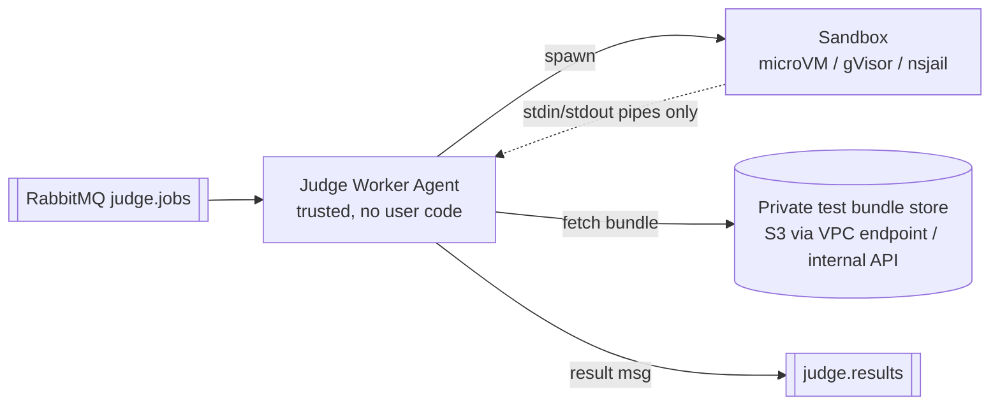

# 10 — Secure Code Execution Architecture

## 1. Isolation options evaluated

| Option | Isolation strength | Ops complexity | Perf/startup | AWS fit | Verdict |
|---|---|---|---|---|---|
| Plain Docker | Shared kernel; weak against kernel exploits | Low | Fast | ECS/EC2 | **Not sufficient alone** |
| nsjail / isolate (namespaces+seccomp+cgroups) | Medium (shared kernel, tight syscall surface) | Medium | Very fast (ms) | Any EC2 | Good for inner layer |
| gVisor (runsc) | Strong-ish (user-space kernel, reduced host syscall surface) | Medium | Fast-ish, syscall overhead | EC2 (not Fargate) | Good |
| Firecracker microVM | Strongest (hardware virtualization, own guest kernel) | Higher | ~125ms+ boot, snapshots help | Needs `.metal` or nested virt EC2 | **Best for public untrusted** |
| Fargate-per-submission | Strong (Firecracker underneath) | Low | Slow (seconds) | Native | Too slow/expensive per run |
| Third-party (Judge0 / Piston) | Varies; Judge0 uses isolate | Low | OK | Self-host | Viable for MVP; evaluate |

### DECISION (2026-11-23, product-owner constraint: free, secure, maintainable, Spring-integrable)

**Build a thin custom judge worker on top of `isolate` (open-source sandbox used in programming-contest systems), running inside a dedicated, no-egress VM. Do not adopt Judge0 as the engine.** Keep a swappable `Sandbox` interface so gVisor/Firecracker can be added later.

Cost: software is **$0 licensing** (isolate: GPL-2.0, used as an external binary; g++/OpenJDK/CPython: free). Operational cost is the compute for the worker VM(s) — not free; see §1.2.

#### 1.1 Why not Judge0 CE (evaluation)
| Criterion | Judge0 CE | Custom worker + isolate |
|---|---|---|
| License cost | Free (GPL-3.0; used as a separate HTTP service) | Free |
| Sandbox | Uses isolate internally | Uses isolate directly |
| Fit with our architecture | Brings its own Rails API, Sidekiq, Postgres, Redis and its own queue/result model — **duplicates** our RabbitMQ/outbox/state machine, test-case storage and idempotency rules | Plugs straight into `judge.jobs`/`judge.results`; one source of truth |
| Hidden-test protection | Test data/expected output pass through its API; our "judge-only, injected at run time" model needs workarounds | Native |
| Future function-signature drivers, special checkers | Awkward (we'd wrap/pre-process outside it) | First-class (driver templates, checker stage) |
| Operational requirements | Needs privileged containers; reported historically to need cgroup v1 on the host, which conflicts with modern cgroup-v2-only distros (**verify in spike**) | We choose host OS/kernel, use isolate's cgroup v2 support |
| Security track record | Had published sandbox-escape CVEs in 2024 that were fixed in later releases — shows the surface is real and that we'd depend on upstream patch cadence (**verify current status**) | We own the (small) surface; still must patch isolate/kernel |
| Effort | Lowest initially | Moderate (~2–3 weeks for a solid worker) |
| Maintainability | Ruby stack nobody on the team may know | Java (our stack), small codebase |
| Spring Boot integration | HTTP polling/callbacks | RabbitMQ (already designed) |

Judge0 would save a few weeks but adds a second system with overlapping responsibilities, which cuts against "avoid unnecessary complexity". Reconsider only if the Phase 0 spike shows the custom worker is taking materially longer than estimated.

Other free options considered: **nsjail** (similar to isolate, Google-maintained; viable alternative — isolate chosen for contest-judging maturity, built-in per-box cgroup/time/memory accounting and meta file), **gVisor** (stronger isolation, syscall overhead, extra ops — added later as outer layer if desired), **Firecracker** (strongest; needs KVM-capable hosts, i.e. bare-metal or nested-virt instances, higher ops — Phase 12/hardening), **Piston** (similar tradeoffs to Judge0, less maintained).

#### 1.2 Deployment model & costs
- **Layered isolation:** (1) dedicated judge VM(s) in an isolated subnet, **no internet egress, no IAM role**, only RabbitMQ + internal test-bundle access; (2) `isolate` boxes per run (namespaces, cgroups v2, rlimits, unique UID, read-only rootfs binds); (3) seccomp filter where isolate/our launcher applies it; (4) VM is disposable/rebuilt from a versioned image.
- **Not Docker-only.** Docker may host the *agent* but the boundary for user code is isolate-in-VM. Rootless-container hosting of isolate is possible but needs care (isolate needs privileges to create namespaces/cgroups) — decide in spike.
- **Costs/limitations (to document honestly):**
  - Needs Linux with cgroup v2 + root/setuid for isolate: **cannot run on Fargate or macOS**. Local dev needs a Linux VM (Lima/Multipass/Docker Desktop's Linux VM with `--privileged` for dev only) — see doc 18.
  - Compute is the cost: start with 1 small–medium instance (e.g. 2–4 vCPU) ≈ low tens of USD/month; scale by queue depth. Judging is CPU-bound; one concurrent slot per core for stable timing.
  - Shared-kernel isolation: a kernel 0-day could escape. Mitigations: no egress, no secrets on host, disposable hosts, patching cadence, invite-level traffic until reviewed, Firecracker/gVisor upgrade path.
  - Timing is approximate (noisy neighbors, JVM warm-up); mitigated by pinned cores, per-language limit multipliers, and not guaranteeing sub-10 ms precision.

#### 1.3 Phased hardening
- **Phase 4:** isolate worker in no-egress VM, hostile-program corpus in CI, quotas.
- **Before wide public launch:** external review; evaluate gVisor as an outer runtime or Firecracker hosts if budget allows.
- Docker alone is explicitly **not** the final boundary for a public service.

### 1.4 Initial languages (confirmed): Java, Python, C++

| Lang | Compile | Run | Notes |
|---|---|---|---|
| C++ | `g++ -std=c++17 -O2 -pipe -static` (static simplifies sandbox rootfs; `-fno-...` flags tuned) | `./a.out` | Compile in separate box w/ larger limits; cap source size, compile time/mem, and error output; block `#include` of absolute paths/`/dev/*` abuse via read-only minimal rootfs |
| Java | `javac Main.java` (single public class `Main`, file name fixed server-side) | `java -Xmx<ML> -Xss<..> -XX:+UseSerialGC Main` (+ further JVM flags chosen and benchmarked in the Phase 4 spike) | JVM needs more procs/threads and memory overhead: separate limits profile (e.g. ≤ 64 procs, ML + ~64 MB slack); wall/CPU multiplier ×2 default |
| Python | none (optionally `py_compile` for syntax-error reporting) | `python3 -B main.py` (isolated-mode flags decided in spike) | Multiplier ×3–5; no bytecode writes |

Language definitions live in the `languages` table (+ image digest) so adding C#, Go, JS, TS, C later is data + image work, not a redesign.

**Verdict mapping** from isolate meta (exit status, `status` TO/SG/RE/XX, `time`, `time-wall`, `max-rss`/cg-mem, cg-oom-killed): TLE, MLE, RE (non-zero exit/signal), CE (compile stage non-zero), OLE (output cap) → persisted as RE/OLE, WA/AC via checker, IE (isolate/agent fault).

### 1.5 Problem model: stdin/stdout now, signature-ready
- v1 `ProblemExecutionSpec { mode: STDIO, checker: EXACT|TOKEN|FLOAT }`.
- The job message carries `mode` and a `driverRef` (null in v1). Future `mode: FUNCTION` adds a **driver-generation stage** (typed signature → per-language wrapper that parses stdin JSON, calls the user's function, prints result) **inside the worker pipeline** before compile, and a `checker` stage after. Because compile/run/check are already separate pipeline stages and the `languages`/`problem_language_configs` tables already carry `driver_template_key`, FUNCTION mode needs no schema or queue redesign.
- Special-judge (custom checker program) is a later `checker: SPECIAL` run in its own sandbox.

## 2. Worker architecture

- Agent is trusted code that never executes user input; sandbox is per-run, destroyed after.
- Judge subnet: **no internet egress**, VPC endpoints only for S3/SQS-like needs; security groups allow RabbitMQ + internal API only. No instance role beyond reading the test bundle prefix + queue creds.
- Compilers/runtimes baked into immutable images (AMI/rootfs) built in CI, scanned, versioned; language registry records the image digest so results are reproducible.

## 3. Per-run controls

| Control | Setting (initial, tunable per language/problem) |
|---|---|
| CPU | 1 vCPU quota, CPU-time limit = problem TL × multiplier |
| Wall clock | TL × 2 + slack, enforced **outside** sandbox |
| Memory | Problem ML (default 256 MB) hard cgroup limit; JVM/Node heap flags set |
| Processes/threads | ≤ 32–64 (JVM needs more), no fork bomb |
| Disk | tmpfs workdir ≤ 64 MB; rootfs read-only; output file size cap |
| Output | stdout/stderr capped (e.g. 1 MB → OLE/truncate) |
| Network | none (no interfaces beyond loopback) |
| Syscalls | seccomp allowlist per language profile |
| User | unique unprivileged UID/GID per run, no capabilities, `no_new_privs` |
| Env | scrubbed; no secrets mounted |
| Compile stage | Separate sandbox phase with its own (larger) time/mem limits, no network; compile output capped & sanitized |
| Cleanup | Destroy VM/namespace + wipe tmpfs; reap orphan procs; host health check and recycle after N runs |

Hidden tests are fed via stdin pipe (or a read-only mount populated post-compile and unlinked) — never present while user compile step runs. Checker/special-judge code runs in its own sandbox, separate from user code.

## 4. Submission lifecycle & reliability
1. API: validate (lang enabled, size ≤ 64 KB, quota, rate limit), persist `QUEUED` + outbox in one TX → `202`.
2. Relay publishes `judge.jobs` message `{submissionId, attempt, problemId, testcaseVersion, languageId, imageDigest}` — **source is fetched by worker by id** (or included, encrypted) rather than trusted from message.
3. Worker consumes with **manual ack**, prefetch=1 (per slot). Marks `RUNNING` (via result channel `started`).
4. Compile → run tests (stop on first failure unless scoring all) → emit `judge.result`.
5. API consumer is idempotent: dedupe on `(submissionId, attempt)`; state machine rejects regressions.
6. Worker crash → message redelivered (ack not sent) → `attempt++`; after N (3) failures → DLQ + `INTERNAL_ERROR`, alert.
7. **Visibility timeout sweeper**: submissions `RUNNING` > T with no heartbeat are re-enqueued.
8. Poison messages → DLQ with alerting; runbook for replay.
9. Run (sample) mode uses a separate high-priority, short-TTL queue; results not persisted beyond short Redis TTL.

Timing fairness: run each test on a pinned core, warm JVM disallowed across submissions; record measurements as relative, not absolute guarantees.

## 5. Driver code (function-signature problems)
For LeetCode-style problems we generate per-language drivers from a typed signature (`int[] nums, int target → int[]`), deserialize JSON-ish test input in the driver, and compare output via the problem's checker. Drivers are authored templates in trusted storage; users edit only the solution class. (Decision OQ-06: stdin/stdout-only for MVP vs. full signature mode.)

## 6. Observability
Metrics: queue depth, job latency, verdict distribution, sandbox startup time, OOM-kills, timeouts, host recycle rate, DLQ size. Logs include `submissionId` but **never source code or test data**.

## 7. Abuse protections
Per-user concurrent limit (e.g. 2), per-minute/day quotas by tier, global queue backpressure (reject with 429 over threshold), code-size cap, fingerprint dedupe of identical rapid resubmits, account-age limits for new accounts, anomaly detection on mass-failing resource-exhaustion patterns.

## 8. Test plan (judge)
Hostile-program corpus: fork bomb, memory bomb, infinite loop, stdout flood, `/proc`/`/sys` probing, network attempts, symlink/path traversal, ptrace, huge stack, deep recursion, compile bombs, reading expected output files, timing probes. All must yield a clean verdict, no host impact, full cleanup. Run in CI against the sandbox image on every change to worker/images.

## 9. Problem validation harness (design, M3.3; executed by this judge in Phase 4)

**Goal (docs/20 §8, PROB-008):** no problem is published unless its expected outputs were produced by a machine, not by trust. Authors supply three programs per problem (stored in `problems.validation_programs`, any of Java/Python/C++): a **reference** solution (claimed correct and efficient), a **brute-force** solution (slow but obviously correct) and a **generator** (reads a seed, prints one valid input). A *validation run* (`problems.validation_runs`) asks the judge to:
1. run the reference on **every stored test** of the run's test-set version and compare with the expected output using the problem's checker (`exact`/`token`/`float`);
2. for seeds 1..N (N = 1..500) run the generator, feed its output to reference **and** brute force, and compare the two outputs with the same checker;
3. enforce the problem's time/memory limits on the reference (the brute force may use a larger time limit, decided in the Phase 4 spike); any mismatch, crash, timeout or limit violation fails the run and returns a **minimal counterexample** (input, expected, actual; each clipped to 2,000 characters and stripped of control characters).

**Contract with the judge:** the problems module exposes `ValidationExecutor` (implemented by the judge: `available()`, `submit(Job)`) and `ProblemValidationApi` (called by the judge: `job(runId)`, `tests(problemId, version)`, `started(runId)`, `accept(runId, outcome)`). A `Job` names the run, problem, **exact test-set version**, checker, limits, N and the three programs with their SHA-256; hidden test data is *not* embedded and is fetched with `tests(problemId, version)` (the judge-side transport and its mTLS/JWT are Phase 4). With no available executor a run is recorded as `unavailable` and nothing can be verified.

**Trust boundary (`ValidationService.accept`):** the only path to `validation_status = verified`. It ignores unknown/finished runs (results are never applied twice or late); under a row lock it requires the problem's **test-set version and program hashes to equal those of the run** (else the run becomes `stale`); a "passed" outcome must report **every stored test and every generated case checked** and no counterexample (else `error`); a failed outcome keeps the problem unverified and stores the bounded counterexample. Any change to a program, the test set, the checker or the limits resets verification and marks active runs stale; at most one run per problem is active (partial unique index), at most 10 are requested per problem and hour.

**Threat model notes:** validation programs are **untrusted code written by authors** and must run in exactly the same sandbox as submissions (no network, cgroup/seccomp limits, no secrets, separate sandbox from the checker) — never on the web/API host; the API only stores them as text (size-capped at 64 KB, control characters rejected, shown as text, audited by hash without the source). Generator determinism: the same seed must produce the same input (the judge re-runs failing seeds to print the counterexample). Not designed yet: an input **validator** program (verifying generated inputs satisfy the constraints), special checkers (`SPECIAL`), multiple reference languages, function-signature problems.
